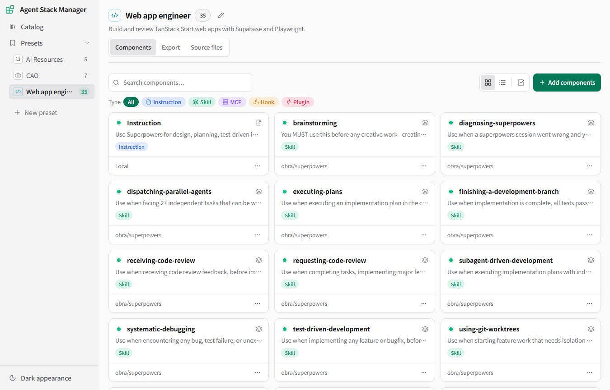

# Agent Stack Manager

Agent skills, stacks and presets kept in one place as Microsoft APM packages, with a local dashboard and automatic export to Paperclip.



## Why

Agent stacks change fast. Following them needs one central place to keep and organize skills, and to say what each agent is made of. Agent Stack Manager (ASM) is that place: an agent stack centralization effort.

It works in three units:

- **Agent config component**: one Instruction, Skill, MCP server, Hook or Plugin, with its source repository when it comes from one.
- **Stack**: components that are used together.
- **Agent preset**: one role. Its Instruction, its components and the stacks it includes, more than a list of skills.

Every stack and preset is a [Microsoft APM](https://github.com/microsoft/apm) package in `packages/`, the common language. ASM keeps its own labels (title, icon, Paperclip role) under `x-preset-labels` in `apm.yml`; there is no second preset format. The aim is that ASM exports each preset from APM into the formats apps such as Paperclip and CC Switch read, and imports their formats back into APM.

## What each app supports

| Component | Paperclip | Claude Code | Codex | CC Switch (Claude Code · Codex) |
| --- | --- | --- | --- | --- |
| Instruction | [AGENTS.md](https://github.com/paperclipai/paperclip/blob/master/docs/companies/companies-spec.md) | [CLAUDE.md](https://code.claude.com/docs/en/memory) | [AGENTS.md](https://learn.chatgpt.com/docs/agent-configuration/agents-md) | [Prompts: CLAUDE.md · AGENTS.md](https://github.com/farion1231/cc-switch#supported-features-by-tool) |
| Skill | [Skills](https://github.com/paperclipai/paperclip/blob/master/docs/guides/agent-developer/skills-store.md) | [Skills](https://code.claude.com/docs/en/skills) | [Skills](https://learn.chatgpt.com/docs/build-skills) | [Skills · Skills](https://github.com/farion1231/cc-switch#supported-features-by-tool) |
| MCP | [Not documented](https://github.com/paperclipai/paperclip/blob/master/docs/companies/companies-spec.md) | [MCP servers](https://code.claude.com/docs/en/mcp) | [MCP servers](https://learn.chatgpt.com/docs/extend/mcp) | [MCP · MCP](https://github.com/farion1231/cc-switch#supported-features-by-tool) |
| Hook | [Not documented](https://github.com/paperclipai/paperclip/blob/master/docs/companies/companies-spec.md) | [Hooks](https://code.claude.com/docs/en/hooks) | [Hooks](https://learn.chatgpt.com/docs/hooks) | [Not managed](https://github.com/farion1231/cc-switch) |
| Claude Code plugin | [Not documented](https://github.com/paperclipai/paperclip/blob/master/docs/companies/companies-spec.md) | [Plugins](https://code.claude.com/docs/en/plugins) | [Not documented](https://developers.openai.com/codex/plugins/build/) | [Not managed](https://github.com/farion1231/cc-switch) |
| Codex plugin | [Not documented](https://github.com/paperclipai/paperclip/blob/master/docs/companies/companies-spec.md) | [Not documented](https://code.claude.com/docs/en/plugins) | [Plugins](https://developers.openai.com/codex/plugins/build/) | [Not managed](https://github.com/farion1231/cc-switch) |

Each cell is the app's own term, linked to the page that says so; "Not documented" means that page says nothing on it. The table is [`catalog/consumers.json`](catalog/consumers.json), and the dashboard's Export tab shows it for each preset with its counts. What an app does not take, or an export leaves out, stays in the APM package, so the same preset serves the next app.

## Export

Saving a preset converts it for Paperclip and writes it to `exports/paperclip/<id>/`; commit the changed files with Git. Every component is accounted for: exported, left out as expected (with the reason), or needs attention. Import a folder by hand as [docs/paperclip.md](docs/paperclip.md) describes.

```sh
python -m asm_app export          # rewrite exports/paperclip/ and list what each preset leaves out
python -m asm_app export --check  # write nothing; fail if exports/paperclip/ is out of date
```

Not built yet: export for Claude Code, Codex and CC Switch, and importing their formats back into APM.

## Presets in this repo

- **CAO** ([package](packages/cao), [export](exports/paperclip/cao)): takes the human's request and delegates it. Four skills, the `session-report` plugin and the `cao-stop` hook.
- **AI Resources** ([package](packages/ar), [export](exports/paperclip/ar)): researches, builds and hires roles as presets in ASM. Three skills from their repositories and its own `technology-research`.
- **Web app engineer** ([package](packages/web-app-engineer), [export](exports/paperclip/web-app-engineer)): builds and reviews web apps. 31 skills, the Playwright MCP server, the `frontend-design` plugin and the `web-session-start` hook.

The two hooks only echo a line, and the two plugins are there to show how an export reports a hook and a plugin.

## What ASM is not

- Not connected to any app: it reads nothing from one, imports nothing into one, and does not know whether an import succeeded.
- Not an agent runner: no button starts an agent or research.
- Not a version pin: a component from a repository follows its branch, never a commit, so an app that tracks the branch gets its updates.
- Not a workaround: it does not make an app take what the app's docs do not support.
- Not hosted: the dashboard runs on your machine, on loopback.

## Run

Python 3.11 or newer:

```sh
git clone https://github.com/kwonzweig/agent-stack-manager
cd agent-stack-manager
python -m pip install -e .
python -m asm_app serve
```

Open [127.0.0.1:4319](http://127.0.0.1:4319) in Chrome (`--port` picks another). The dashboard edits the files in your clone: browse the Catalog with each repository's GitHub stars, add components to a stack or preset, edit a preset, and read its Export tab.

## APM lock

The optional APM CLI resolves a package's dependencies into `apm.lock.yaml` without deploying anything into an app's folders. The lockfile records the commit each branch [resolved to](https://github.com/microsoft/apm/blob/main/docs/src/content/docs/reference/lockfile-spec.md) when it ran; the presets and the Paperclip exports keep naming branches.

```sh
python -m pip install -e '.[apm]'
python -m asm_app lock web-app-engineer   # --update resolves again from upstream
```

## Development

```sh
python -m unittest discover -s tests
python -m asm_app export --check
cd frontend && npm ci && npm test && npm run build
```

The built dashboard is committed in `asm_app/web/`, so running it needs no Node.js; rebuild it with Node.js 22.12 or newer and commit it with the source. The data files and the local API are in [docs/api-contract.md](docs/api-contract.md); reused frontend code and its licences are in [frontend/IMPLEMENTATION.md](frontend/IMPLEMENTATION.md).
